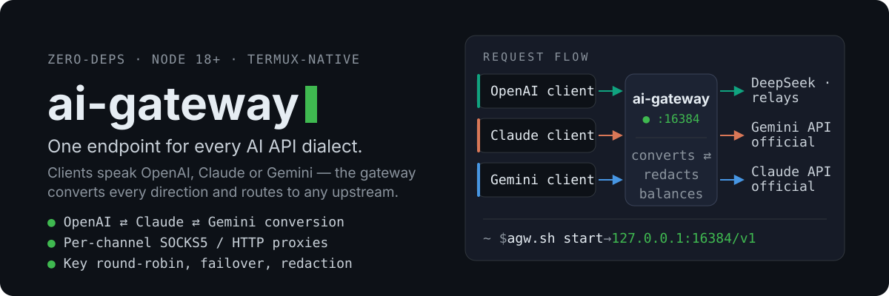

# ai-gateway — one endpoint for every AI API dialect

<p align="center">
  
</p>

A **zero-dependency** Node.js gateway (born on Termux, happy on any Linux / macOS box): accept requests from **any** AI client, serve them from **any** upstream — OpenAI, Claude, and Gemini formats are converted in every direction, streaming included. Outbound traffic can ride a per-channel **SOCKS5 / HTTP proxy**.

```text
Client (any dialect)                       Upstream (any dialect)
OpenAI ──┐                            ┌──▶  OpenAI official / DeepSeek / relays / llama.cpp
Claude ──┼──▶  ai-gateway :16384  ────┼──▶  Gemini official
Gemini ──┘    convert ⇄ redact       └──▶  Claude official
              balance ⇄ proxy              direct, or per-channel SOCKS5 / HTTP proxy
```

- **Clients stay unchanged** — ChatBox, NextChat, Claude Code, and the OpenAI / Anthropic / Google SDKs all just point at the gateway.
- **Same format = byte-for-byte passthrough**; mixed formats get full conversion — streaming SSE, tool calls, images, thinking content, token accounting.
- **Keys stay flexible** — one model name on several channels: round-robin rotation, automatic failover on 429 / 401 / 5xx / connection errors, invisible switching.
- **Zero npm dependencies** — if Node.js runs, it runs. No `npm install`, no build step.

---

## Quick start

Needs Node.js 18+. Install from a checkout:

```bash
git clone https://github.com/AndyerNotFound/ai-gateway-AI.git ~/ai-gateway
cd ~/ai-gateway
cp data/config.example.json data/config.json   # then add one channel + its API key
bash agw.sh start
node agw.js web login        # panel one-time link (or `agw web login` after install)
```

…or one-shot (Termux / Linux / macOS):

```bash
curl -fsSL https://raw.githubusercontent.com/AndyerNotFound/ai-gateway-AI/main/install.sh | bash
```

Smoke test:

```bash
curl http://127.0.0.1:16384/v1/chat/completions \
  -H "Content-Type: application/json" \
  -d '{"model":"deepseek-chat","messages":[{"role":"user","content":"hello"}]}'
```

## Speak any dialect

Point existing apps at the gateway — no code changes; whatever the client speaks reaches any upstream:

| Client speaks | Endpoint | Typical clients |
|---|---|---|
| OpenAI | `POST /v1/chat/completions` · `GET /v1/models` | ChatBox, NextChat, openai SDK, most "custom OpenAI" apps |
| Claude | `POST /v1/messages` | Claude Code, anthropic SDK |
| Gemini | `POST /v1beta/models/{model}:generateContent` (`:streamGenerateContent` for SSE) | Google AI SDKs |

`<host>` is the machine or phone running the gateway (`127.0.0.1` locally, its LAN IP for other devices — `ip -4 addr`). If `gatewayKey` is set, it is accepted anywhere a key belongs: `Authorization: Bearer`, `x-api-key`, `x-goog-api-key`, or `?key=`.

## Routing, conversion, balancing

```jsonc
// data/config.json (excerpt)
{
  "listen": { "host": "0.0.0.0", "port": 16384 },
  "gatewayKey": "",                      // set a password before exposing LAN / internet
  "panel": { "openBrowser": true },      // agw web login: open the login link in a browser
  "proxies": {
    "clash": { "type": "socks5", "host": "127.0.0.1", "port": 7890 }
  },
  "channels": [
    { "name": "gemini-official", "type": "gemini",
      "baseUrl": "https://generativelanguage.googleapis.com",
      "apiKey": "AIza...", "proxy": "clash", "models": ["gemini-2.5-flash"] },
    { "name": "deepseek-key1", "type": "openai",
      "baseUrl": "https://api.deepseek.com",
      "apiKey": "sk-...", "models": ["deepseek-chat"], "default": true },
    { "name": "deepseek-key2", "type": "openai",
      "baseUrl": "https://api.deepseek.com",
      "apiKey": "sk-...", "models": ["deepseek-chat"] }
  ]
}
```

- **Model → channel**: exact hit in `modelMap` → the `models` list → the `default` channel → the first channel. `modelMap` renames too: `{"gpt-4o": "gemini-2.5-flash"}` serves a Gemini model to a GPT client.
- **Conversion covers streaming, tool calls, images, thinking content, and usage/token accounting.**
- **SSE streams are never scrubbed.** Same-format bytes pass through intact (or are converted event-by-event); `dsmlClean` / channel `transcreet` applies to non-streaming JSON responses only. Privacy filtering remains a separate, optional feature. A failing channel (429 / 401 / 500–504 / connection error) transparently retries on the next one; genuine client errors (`400`) come back as-is. Once a stream has started, the current channel is locked in.
- **Per-channel egress**: each channel can route through its own proxy (`"proxy": "clash"`), so Gemini/Claude can exit somewhere else than DeepSeek. `insecure: true` tolerates self-signed relays.

### Privacy filter

On by default for requests; `redact.response: true` also masks the response direction.

- Masks values under sensitive fields (`api_key`, `token`, `password`, `authorization`, …) and pattern-matches built-ins: `sk-` keys, GitHub / Slack / AWS / Google / GitLab / HuggingFace tokens, `Bearer` headers, emails, mainland-China mobile numbers, national IDs, bank cards (Luhn-validated), private IPv4.
- **Streaming-safe**: SSE chunks are filtered so secrets split across fragments are still caught.
- **Fast path**: text without sensitive traits skips regex entirely; long contexts use a chunk-level cache that recomputes only changed parts.
- Custom rules: `redact.extra` regexes, editable in the panel, hot-reloaded.

## Managing the gateway

One process hosts every instance; create / rename / start / stop / edit instances hot from the panel — no restarts.

**Seamless restart.** `agw.sh start` runs a master process that owns the listening sockets plus one worker that serves traffic. `agw.sh restart` (also `reload`, or saving config in the panel) forks a replacement worker, waits until it is listening, then tells the old worker to stop accepting and drain; the old worker exits after its last in-flight response. New requests never fail and **in-flight streams are not cut** — the socket stays in the master, only the code is swapped. What still breaks is a worker that *crashes*: a socket cannot be moved between processes, so streams running at that instant die. Set `AGW_HOT=0` to run the old single-process mode.

```bash
bash agw.sh start | stop | restart | reload | status | list | logs | show
bash agw.sh config <instance> add | list | remove | set-port | set-key   # channels from the terminal

agw web login [--inst <instance>] [--open|--no-open]   # one-time panel login link
agw web [--inst <instance>]                            # session-id / token state
agw web --expired [--inst <instance>]                  # revoke all panel sessions
```

- **Web panel** — run `agw web login`; it prints `http(s)://<host>:<port>/auth/<session-id>/<token>`. The `session-id` is regenerated on every gateway start, and the `token` is regenerated by every login command, valid for 15 minutes and consumed on first use. Set `panel.openBrowser: false` to stop auto-opening the browser. Material 3 UI, mobile bottom bar, key cards, stats, requests, logs, chat. Optional Material You color bridge (`mduCmd` or `mdu.json` → `GET /admin/api/mdu`) to tint the panel like your phone.
- **Key cards** — issue prepaid card keys (generate / charge / ban, registration on/off) so other people can use a model without ever seeing a channel key; holders get self-service pages under `/auth`.
- **HTTPS without root** — `agw-tls setup` enables it in one shot; `agw-tls all` does the same for every instance. **One entry per instance, never a plaintext twin:** the main port serves HTTPS only on `listen.port`, and an instance with TLS on stops listening on its own port — it is reachable only via the main port's HTTPS at `/<instance>/`. A broken certificate fails closed rather than silently serving plaintext. Local private CA, per-device trust, automatic re-sign on IP change, <7-day certificate auto-renew and 90-day client-key rotation driven by `ops/guard.sh`. `agw-tls status` / `agw-tls use` for state and ready-made client snippets. `agw-tls export` drops the CA certificate into `/sdcard/Download/ai-gateway/` (with an install guide, auto-deleted after 30 minutes by default, `--keep 0` to keep); the private key is never exported.
- **Config encryption & portability** — encrypt config files at rest, export / import as JSON or QR code (`bash agw.sh config`).
- **Docker** — `docker compose up -d` (port 16384, state in the `ai-gateway-data` volume); panel link: `docker compose exec ai-gateway node /app/agw.js web login`.

### OpenAI extended endpoints (fixed behavior)

`POST /v1/responses` is always available — a full conversion endpoint (streaming, tool calls, reasoning) between Responses and Chat/Claude/Gemini bodies. Every other `/v1/*` path that is not a conversion entry or a gateway-local route is always forwarded verbatim to an OpenAI-type channel: `images`, `embeddings`, `audio/speech`, `audio/transcriptions`, `audio/translations`, `completions`, `moderations`, `files`, `batches`, `vector_stores`, …; method, path, query, multipart and binary bodies are preserved. Channel-level `useResponses: true` lets an OpenAI upstream speak the Responses API.

### Channel path lock

An optional channel-level `path` pins **all** requests on that channel to one exact upstream path:

```jsonc
{
  "name": "relay",
  "type": "openai",
  "baseUrl": "https://relay.example.com",
  "path": "/custom/v1/chat/completions"
}
```

- Upstream URL = `baseUrl + path`; the client path and query are ignored. This also applies to conversion requests.
- Omit `path` (or set it to `""`) for automatic behavior: conversion endpoints use their dialect-specific path, and non-conversion `/v1/*` requests pass through with the client path + query.
- `path` must start with `/`; a full URL is rejected. For Gemini streaming with a locked path, include any required query (for example `?alt=sse`) in `path` yourself.
- `path` only controls the URL. The request body dialect still follows the channel type, `useResponses`, and the client API (for example, a Responses client with a chat-locked path needs `useResponses: false` to send a chat body).

## Security notes

1. `0.0.0.0` + empty `gatewayKey` means anyone on the Wi-Fi can spend your keys. Set `gatewayKey` before LAN / internet exposure; use `127.0.0.1` for localhost-only.
2. Public paths are whitelisted: only `/v1`, `/v1beta`, `/auth`, `/profile`, and `/admin` exist — everything else 404s.
3. Config files hold your (optionally encrypted) upstream keys; do not share the directory. Runtime `data/.run/panel-*.json` holds only hashes, the session-id, and a local admin token (mode 0600).
4. Panel login always requires the one-time link; an empty `webToken` no longer makes the panel keyless over the network. `webToken` remains an optional long-lived API token for scripts.
5. Redaction is on by default; `redact.enable: false` turns it off for the instance, and a key card may additionally opt out with `redact=false`.

## Project layout

```text
ai-gateway-AI/
├── gateway.js        # entry: master (owns the sockets) + worker (serves traffic)
├── hot.js            # hot restart: worker swap + in-flight drain
├── server.js …       # routing, conversion, balancing, redaction — one focused module each
├── sse.js            # spec-compliant SSE parser: LF/CRLF/CR, EOF flush, tolerant decoder
├── panel-auth.js     # panel session-id + one-time login token (file-based)
├── m3/               # web panel (Material 3, vanilla ESM, zero CDN)
├── agw.sh / agw-tls  # lifecycle + HTTPS management
├── data/             # config.json per instance, logs, pids
├── tls/  ops/        # private-CA scripts, renewal / rotation watchdog
└── test/             # sandbox test suite
```

Tests: `node test/balance_test.js` (77 balance-passthrough / routing assertions), `node test/redact_test.js` (40 redaction cases), `node test/panel_auth_test.js` (one-time link / session rotation / API auth), `node test/utf8_split_test.js` (chunk-split decoding), `node test/sse_stream_test.js` (one-byte SSE fragments, CRLF/CR, EOF without newline, DSML pass-through, whitespace-only deltas), `node test/sse_convert_test.js` (cross-format SSE + response redaction across fragments), `node test/dsml_nonstream_test.js` (non-stream DSML scrubbing/backfill), `node test/path_lock_test.js` (channel `path` lock + fixed passthrough), `node test/hot_restart_test.js` (worker swap with an in-flight SSE stream) and `node test/hot_pool_test.js` (same across instance ports) run anywhere; the full converter matrix (all 9 dialect pairs, streaming and not) and proxy/auth/failover E2E run in the maintainer's sandbox — 215/215.

## License

[GPL-3.0](LICENSE)
